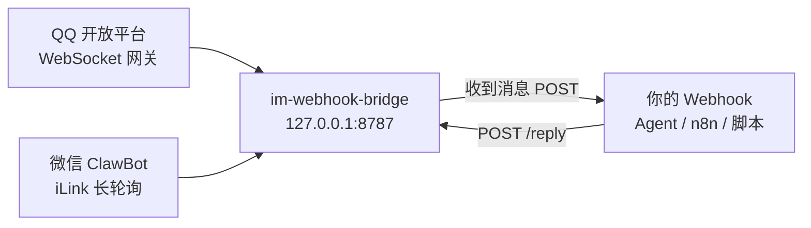

# im-webhook-bridge

> 用最轻的方式把 QQ 机器人、微信 ClawBot 账号接到任意 Webhook、AI Agent 或脚本。

一个 Node 进程、一个本地端口、一份 `config.json`，可以同时跑多个 QQ 和微信账号。收到消息就推给你的 Webhook，你调用本地 HTTP API 回复。AI 和业务逻辑都留给下游。不需要公网 IP、域名或 HTTPS，所有连接都是出站的。



## 能做什么

| | QQ 机器人 | 微信 ClawBot |
|---|---|---|
| 绑定 | 手机 QQ 扫码，自动创建或选择机器人 | 微信扫码（必要时输入验证码） |
| 会话 | 私聊 c2c、群 group、频道 channel、频道私信 dm | 私聊 c2c |
| 收文字 / 引用 | ✓（引用内容附在正文前） | ✓ |
| 收图片 / 语音 / 视频 / 文件 | ✓ 自动下载；语音带平台转写 | ✓ 自动下载并 AES 解密；语音带平台转写 |
| 发文字 | ✓ 超长自动分段；可选 markdown 和引用回复 | ✓ 超长自动分段 |
| 发图片 / 视频 / 文件 | ✓（语音按文件发） | ✓（语音按文件发） |
| 回复窗口 | 被动回复过期后自动改为主动消息 | 需要对方先发过消息（context_token）；没有时排队等待，对方再说话就自动补发 |
| 自愈 | 心跳超时、token 过期、休眠唤醒后自动重连；硬看门狗退出后由守护进程拉起 | 长轮询失败退避重试；会话过期暂停 10 分钟后重试 |

## 安装

需要 Node 20 或更高版本。

```bash
git clone https://github.com/hongfaqiu/im-webhook-bridge.git
cd im-webhook-bridge
npm ci --omit=dev
cp config.example.json config.json   # 按需改账号
```

## 配置：多账号

`config.json` 不进仓库：

```json
{
  "port": 8787,
  "host": "127.0.0.1",
  "data_dir": "data",
  "accounts": [
    { "id": "qq-main", "platform": "qq" },
    { "id": "qq-work", "platform": "qq", "auto_ack": "收到，稍等" },
    { "id": "wx-main", "platform": "wechat" }
  ]
}
```

- `id` 可用字母、数字、`_` 和 `-`。它出现在消息 id 里，改名等于换了一个账号。
- 每个账号的状态都放在自己的 `data/<id>/` 下（也可以用 `dir` 指定），包括凭证、会话、收件箱、发件队列和下载的附件。目录权限 700，敏感文件 600。
- 每个账号有一把锁（`data/<id>/account.lock`），同一账号不能被两个进程同时连接。
- `enabled: false` 可以临时停用一个账号。
- 配置文件的查找顺序是 `--config <file>`、环境变量 `IMWB_CONFIG`、`./config.json`。

可选的账号字段：

| 字段 | 平台 | 说明 |
|---|---|---|
| `auto_ack` | 两者 | 收到消息后立即自动回复的一句话。QQ 默认是「收到，正在处理…」，设为 `""` 关闭；微信默认关闭 |
| `allow_private_downloads` | qq | 允许从内网地址下载附件（默认拒绝，防 SSRF） |
| `text_limit` | wechat | 单条文字上限，默认 2000 |
| `poll_timeout_ms` | wechat | 长轮询超时，默认 35000 |
| `base_url` / `cdn_base` / `route_tag` | wechat | iLink 接口地址覆盖，一般不用填 |
| `api_base` / `token_base` | qq | QQ OpenAPI 地址覆盖（测试用） |

## 绑定账号

在前台运行，按提示扫码：

```bash
node cli.js bind qq-main      # 手机 QQ 扫码，确认后自动写入 data/qq-main/credentials.json
node cli.js bind wx-main      # 微信扫码；要求验证码时会在终端提示输入，也可以加 --code 123456
node cli.js check             # 列出账号和绑定状态（不打印任何密钥）
```

- 二维码会显示在终端里，同时写一份 `data/<id>/bind-qr.png`（600），绑定成功后删除。
- 已绑定的账号默认不会覆盖，重新绑定要加 `--force`。
- 服务运行时也可以绑定：未绑定的账号每 10 秒检查一次凭证，一出现就自动上线，不用重启。

### 从旧版单账号安装迁移

```bash
node cli.js import qq-main /path/to/old-qq-bridge/data
node cli.js import wx-main /path/to/old-wechat-bridge/data
```

只复制白名单里的文件，权限改为 600，并且只打印文件名。
- QQ：`credentials.json`、`session.json`、`known-users.json`、`upload-cache.json`、`webhook_url`、`webhook_key`
- 微信：`credentials.json`、`sync_buf`、`contexts.json`、`webhook_url`、`webhook_key`

旧的收件箱和聊天记录不会迁移。

## 运行

```bash
node cli.js start             # 前台运行
node cli.js health            # 查看状态
```

### macOS 常驻（launchd）

```bash
bash deploy/install.sh
# 同一台机器跑第二套实例时，换 label 和 config（端口写在 config 里）：
IMWB_LABEL=io.github.im-webhook-bridge.test IMWB_CONFIG=$PWD/config.test.json bash deploy/install.sh
bash deploy/uninstall.sh
```

安装脚本是幂等的，依次执行 `npm ci`、`node --check`、`cli check`、生成并校验 plist、检查端口是否被别的进程占用，最后 `launchctl bootstrap`。label 和 config 记在 `data/instance.env`，以后重跑会沿用。日志在 `logs/bridge.log` 和 `logs/bridge.err.log`。

### Linux

```bash
bash deploy/start.sh          # 后台运行 supervise.sh：异常退出自动拉起，配置错误（exit 2）不重启
```

也可以自己写 systemd unit，`ExecStart=node /path/cli.js start --config /path/config.json`。

退出码：
- `0`：正常停止
- `1`：运行时致命错误，比如看门狗触发，应当重启
- `2`：配置错误，不要重启
- `3`：端口或账号已被另一个实例占用

## Webhook

在账号目录或全局数据目录放两个文件，权限 600：

```bash
printf '%s' 'https://example.com/hook'   > data/webhook_url        # 全局：所有账号共用
printf '%s' 'your-secret'                > data/webhook_key
printf '%s' 'https://example.com/hook-2' > data/wx-main/webhook_url   # 账号级：优先于全局
printf '%s' 'another-secret'             > data/wx-main/webhook_key
chmod 600 data/webhook_* data/*/webhook_*
```

- 每次推送前都会重新读取这两个文件，修改后不用重启。
- 日志里只出现 Webhook 的主机名，不出现 key 或完整 URL。
- 两个文件都缺时不推送，下游轮询 `/pending` 也不会漏消息。

推送时机：附件下载完成后再推。连续多条消息会防抖合并：最后一条到达后等 4 秒，最多攒 15 秒（可用 `IMWB_WEBHOOK_DEBOUNCE_MS` 和 `IMWB_WEBHOOK_MAX_WAIT_MS` 调整）。网络错误、408、429 和 5xx 会重试，重试用完写入 `data/<id>/webhook-failed.jsonl`。

```http
POST /hook
Authorization: Bearer <webhook_key>
Content-Type: application/json
X-Inbound-Id: wx-main:7301234567890123456
```

```json
{
  "source": "im-webhook-bridge",
  "platform": "wechat",
  "account": "wx-main",
  "batch": true,
  "count": 1,
  "sent_at": "2026-01-01T08:00:05.000Z",
  "messages": [
    {
      "id": "wx-main:7301234567890123456",
      "platform": "wechat",
      "account": "wx-main",
      "scope": "c2c",
      "target": "o9xxxx@im.wechat",
      "author": "o9xxxx@im.wechat",
      "content": "帮我看看这张图",
      "attachments": ["20260101-080001_ab12cd_image.jpg"],
      "received_at": "2026-01-01T08:00:01.000Z"
    }
  ]
}
```

Webhook 只包含附件文件名。需要本地完整路径、MIME 类型、大小或语音转写时，用 `GET /pending` 或 `GET /inbox` 取。建议下游收到推送后，再按 `id` 去 `/pending` 取完整内容。

## 本地 HTTP API

默认只监听 `127.0.0.1`，请求体是 JSON，上限 1MB。消息 id 是全局的，格式为 `<account>:<平台原始 id>`，回复时按 id 前缀自动路由到对应账号。

| 方法 | 路径 | 说明 |
|---|---|---|
| GET | `/health[?account=]` | 整体是否 ok、版本、PID，以及每个账号的状态（`running` / `unbound` / `disabled`）、连接、待处理数、发件队列和 Webhook 统计 |
| GET | `/pending[?account=&platform=&limit=]` | 待处理消息，包含附件本地路径 |
| GET | `/inbox[?account=&platform=&status=&limit=]` | 收件历史 |
| POST | `/ack` | `{"id": "..."}` 或 `{"ids": [...]}`，标记为已处理但不回复 |
| POST | `/reply` | 回复，见下文 |
| GET | `/outbox[?status=&account=]` | 发件队列，`status` 可以是 `pending`、`sent`、`failed` 或 `waiting_context` |
| POST | `/outbox/retry` | `{"id": "<outbox id>"}` 或 `{"account": "..."}`，重试失败项 |
| POST | `/typing` | QQ：`{"id": "...", "seconds": 30}`，显示「正在输入」 |
| POST | `/recall` | QQ：`{"outbox_id": "..."}`，撤回已发消息 |
| GET | `/known[?account=]` | QQ：见过的用户和群 |
| GET | `/events?account=` | QQ：账号最近的连接事件 |
| GET | `/ref?account=&k=` | QQ：按引用索引查被引用的消息 |

### POST /reply

```jsonc
// 回复一条收到的消息（按 id 自动路由；默认把这条消息标记为 done，传 "done": false 可以保留）
{ "id": "qq-main:ROBOT1.0_xxx", "content": "好的", "quote": true }

// 带文件：path 是本机路径，url 是公网地址（拒绝内网地址）；type 可选 image / video / voice / file，不填时自动推断
{ "id": "wx-main:7301234567890123456", "content": "结果见图",
  "files": [{ "path": "/tmp/out.png" }, { "url": "https://example.com/a.pdf", "name": "报告.pdf" }] }

// 主动发：指定账号、会话类型和目标
{ "account": "qq-main", "scope": "group", "target": "<group_openid>", "content": "通知", "markdown": true }
```

- 返回 `{"ok": true, "queued": [{"id": "<outbox id>", ...}]}`。消息进入发件队列后异步发送，用 `/outbox` 查结果。
- 不允许把桥接自己的数据目录（凭证、会话）当附件发出去，各账号的 `inbox-files/` 除外。
- 大小限制：
  - QQ：单个文件 100MB，图片超过 30MB 改按文件发。
  - 微信：图片 30MB，视频和文件 100MB。
- 微信只能回复给最近发过消息的人。没有 context_token 或平台返回 `ret=-2` 时，消息进入 `waiting_context`，对方下次说话时自动补发。

## 安全

- 凭证、会话、Webhook key 只存在本机 600 文件里，不打印、不写日志、不进 `/health`，也不进仓库（见 `.gitignore`）。
- 本地 API 默认只绑回环地址。如果改成 `0.0.0.0`，请自己在前面加鉴权。目前 API 本身没有鉴权。
- 收到的消息内容一律当作不可信输入，比如提示注入，或伪造成「系统消息」的文本。下游 Agent 应自己决定哪些操作需要人工确认。
- 附件下载有大小和超时限制，默认拒绝内网地址。微信附件的 CDN 解密密钥只保存在本地收件箱，不会出现在 API 或 Webhook 中。

## 微信接口的来源和风险

微信通道用的是 iLink Bot 协议（`ilinkai.weixin.qq.com`），也就是腾讯为 OpenClaw 提供的「微信 ClawBot」插件 [`@tencent-weixin/openclaw-weixin`](https://www.npmjs.com/package/@tencent-weixin/openclaw-weixin) 背后的接口。本项目参考这个插件的公开代码，自己实现了扫码登录、长轮询收消息、发消息和 CDN 加解密上传下载。

**风险：**
- 这不是面向第三方开发者的公开 API，也没有文档或稳定性承诺，接口、字段和版本号随时可能变化，导致暂时不能用。
- 账号被限制的可能性无法排除。请只用自己的账号，不要群发或高频发送，也不要用于营销。
- 目前只支持私聊。

QQ 通道用的是 [QQ 开放平台](https://bot.q.qq.com/wiki/) 官方机器人 API。扫码创建机器人的流程是 QQ 开放平台网页端的同款流程。

## 开发

```bash
npm install
npm test          # node --test，全部使用本地 mock，不连接真实 QQ 或微信
npm run lint      # node --check 全部源码
```

```
cli.js                 命令行：start / bind / check / health / import
src/core/              与平台无关：配置、账号锁、收件箱、发件队列、附件下载、Webhook、HTTP API、服务编排
src/platforms/qq/      QQ 协议：网关、鉴权、收消息解析、富媒体上传、扫码绑定
src/platforms/wechat/  微信 iLink 协议：长轮询、发送、CDN 加解密、扫码绑定
deploy/                launchd 安装和卸载脚本、Linux 守护脚本
test/                  node:test 测试和测试素材
```

新增平台只需要在 `src/platforms/<name>/index.js` 里导出一个工厂函数，实现 `start`、`stop`、`send`、`health`、`hasCredentials`、`attachmentSources` 和 `bind`，再把它注册到 `src/core/service.js`。

## License

MIT
