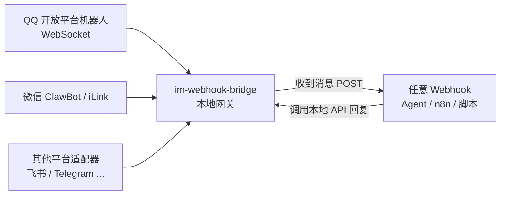

# im-webhook-bridge

> 把 QQ、微信等即时通讯账号，用最轻的方式接到任意 Webhook / AI Agent / 第三方服务。

**状态：设计阶段（idea）。** 本仓库先记录设计思路，代码会从作者自用的 QQ / 微信桥接中逐步抽出来。

## 为什么要做

已有的开源项目（如 [LangBot](https://github.com/langbot-app/LangBot)、[AstrBot](https://github.com/AstrBotDevs/AstrBot)）定位是「自带 AI 的聊天机器人平台」：要部署一整套面板、流水线和模型配置。

很多时候需求更简单：

- 我已经有自己的 Agent / 自动化（Grok Bot、n8n、Dify、自写脚本……），只想让它**收到** QQ / 微信消息，再**回复**回去；
- 不想买公网服务器、配域名和 HTTPS；
- 希望一台家里常开的电脑（Mac mini / NAS / 小主机）扫个码就能跑，开机自启、断线自愈。

im-webhook-bridge 只做一件事：**IM ⇄ 本地统一 API ⇄ Webhook**，AI 和业务逻辑都留给下游。

## 核心设计

1. **扫码即绑定**：每个平台适配器提供扫码 / 一次性登录流程，凭证只保存在本机（600 权限文件），绝不进日志。
2. **统一的本地 HTTP API**（默认 `127.0.0.1`）：
   - `GET /health`：每个通道的连接状态、心跳、最近错误
   - `GET /pending`：待回复消息（统一格式：id、平台、会话、发送者、文本、附件本地路径）
   - `POST /reply`：按消息 id 回复文字 / 图片 / 文件，被动回复窗口过期时自动改为主动消息
   - `POST /ack`、`GET /outbox`、`POST /outbox/retry`：标记已处理、查看和重试发送失败的消息
3. **Webhook 推送**：收到消息后（附件下载完成后）POST 到配置的 Webhook，连发消息做防抖合并，失败自动重试；下游即使只靠定时轮询 `/pending` 也不会漏消息。
4. **不需要公网**：QQ 用官方 WebSocket 通道，微信用 ClawBot 长连接，全部是出站连接。
5. **常驻与自愈**：macOS launchd / Linux systemd 守护；心跳超时、token 过期、长时间无 ACK 时自动重连或退出重启。
6. **多账号、多通道**：一个进程跑多个机器人账号，每个通道可配不同 Webhook 和访问控制（谁的消息可以自动回复、谁需要人工确认）。

## 计划

- [ ] 从现有 QQ 桥接（基于官方 openclaw-qqbot 协议实现）抽出 `adapters/qq`
- [ ] 抽出微信 ClawBot 适配器 `adapters/wechat`
- [ ] 统一消息模型与本地 API
- [ ] Webhook 推送（签名 / Bearer key、防抖、重试）
- [ ] launchd / systemd 安装脚本，一条命令安装
- [ ] 示例：接 Grok Bot 例程、n8n、Dify、纯脚本

## 安全原则

- 凭证、Webhook key 只存本机文件或环境变量，不打印、不入库、不上传；
- 本地 API 默认只监听回环地址；
- 消息内容一律当作不可信输入，下游自行决定哪些操作需要人工确认。

## License

MIT
